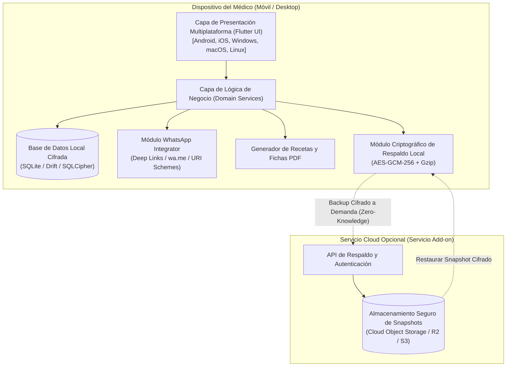

# Documento de Envisioning y Planificación
## MicroApp 1: Gestión Clínica Local-First para Odontólogos y Médicos Especialistas

---

## 1. Declaración de Visión

* **Nombre de la Iniciativa:** MicroApp 1 - *ClinikLocal* (Gestión Clínica y Dental Autónoma Multiplataforma).
* **Visión del Producto:** Proporcionar a odontólogos y médicos especialistas una herramienta de productividad y gestión clínica ultra-rápida, privada y autónoma que opere en cualquier dispositivo (Android, iPhone, Windows, macOS y Linux) almacenando el 100% de la información clínica y de pacientes en el equipo local del profesional, eliminando la dependencia forzosa de internet y tarifas mensuales obligatorias, con integración directa a WhatsApp para comunicación y la opción comercial de respaldo y restauración centralizado en la nube.
* **Propósito Estratégico:** Democratizar el software clínico profesional para consultorios individuales y especialistas independientes, garantizando soberanía de datos y privacidad absoluta para pacientes y médicos.

---

## 2. Metodología Design Thinking

### 2.1. Fase 1: Empatizar (Empathize)

#### Contexto y Dolor Real del Profesional
1. **Costos recurrentes injustificados:** La mayoría de los SaaS médicos cobran suscripciones mensuales elevadas por profesional, aún cuando el consultorio atiende volúmenes moderados o tiene un solo operador.
2. **Dependencia y vulnerabilidad de internet:** Los cortes de fibra óptica, fallas de señal móvil o caídas de servidores en la nube paralizan la atención, impidiendo ver fichas de pacientes o registrar recetas en plena consulta.
3. **Privacidad y cumplimiento médico:** Almacenar historiales clínicos en servidores externos genera recelo ético y legal sobre la custodia de información sensible del paciente.
4. **Fricción en comunicación:** Para avisar a los pacientes o recordarles citas, el médico o su asistente deben copiar manualmente números de teléfono a WhatsApp Web o escribir mensajes repetitivos.
5. **Heterogeneidad de dispositivos:** El especialista suele usar su teléfono (Android o iPhone) para revisar la agenda fuera del consultorio y una laptop/PC de escritorio (Windows, Mac o Linux) mientras atiende en su consultorio.

#### Arquetipos de Usuario (User Personas)

| Arquetipo | Perfil | Necesidad Principal | Dolor Crítico |
| :--- | :--- | :--- | :--- |
| **Odontólogo Independiente** | Dr(a). Odontólogo(a) con consultorio propio o sillón dental alquilado. | Registro de tratamientos odontológicos, presupuestos, historial de intervenciones y recordatorio de citas de control. | Pérdida de tiempo redactando fichas manuales; ausentismo de pacientes a citas de control. |
| **Médico Especialista** | Pediatra, dermatólogo, ginecólogo o traumatólogo independiente. | Ficha clínica ágil, antecedentes del paciente, emisión rápida de recetas e indicaciones y registro de análisis. | Sistemas tradicionales lentos y engorrosos; falta de acceso offline cuando atiende en diferentes clínicas. |
| **Paciente / Cliente** | Persona atendida por el especialista. | Recibir confirmación de citas, recetas claras e indicaciones directamente en su WhatsApp. | Letra médica ilegible en papel, olvido de citas agendadas y pérdida de recetas físicas. |

---

### 2.2. Fase 2: Definir (Define)

#### Problem Statement (Declaración del Problema)
> *"Los odontólogos y médicos especialistas que atienden pacientes en consultorios particulares necesitan gestionar contactos, historias clínicas, recetas y citas de forma rápida, privada e independiente porque las plataformas existentes requieren conexión permanente a internet, cobran tarifas mensuales elevadas y alojan datos médicos sensibles en servidores externos de terceros, lo cual genera interrupciones operativas, riesgos de fuga de datos y una alta tasa de inasistencia de pacientes."*

#### Propuesta de Valor Diferencial

```
+---------------------------------------------------------------------------------+
|                                 PROPUESTA DE VALOR                              |
+---------------------------------------------------------------------------------+
|  1. LOCAL-FIRST & SOBERANÍA TOTAL                                               |
|     * 100% de los datos guardados en el equipo local del médico.                |
|     * Cero latencia, funcionamiento offline 100% garantizado.                   |
|     * Privacidad total (datos clínicos nunca expuestos sin consentimiento).     |
|                                                                                 |
|  2. MULTIPLATAFORMA UNIFICADA                                                   |
|     * Misma experiencia e interfaz fluida en Android, iOS, Windows, Mac, Linux. |
|                                                                                 |
|  3. COMUNICACIÓN INMEDIATA VÍA WHATSAPP                                         |
|     * Envío en 1 clic de recordatorios de cita, recetas y altas médicas.        |
|     * Sin costo de SMS ni intermediarios (mediante deep-links oficiales).       |
|                                                                                 |
|  4. MODELO DE NEGOCIO Y RESPALDO CLOUD (ADD-ON)                                 |
|     * App base de uso local autónomo.                                           |
|     * Servicio comercial de Backup & Restore cifrado en la nube a demanda.      |
+---------------------------------------------------------------------------------+
```

---

### 2.3. Fase 3: Idear (Ideate) & Delimitación del Alcance

#### Matriz de Alcance: MVP vs. Versiones Futuras

| Módulo / Funcionalidad | En MVP (Fase 1) | Fase Posterior (v2.0) | Justificación |
| :--- | :---: | :---: | :--- |
| **1. Directorio de Pacientes y Contactos** | ✅ Sí | - | Registro básico de nombre, teléfono WhatsApp, fecha nacimiento, alergias y contacto de emergencia. |
| **2. Historia Clínica y Fichas Médicas** | ✅ Sí | - | Registro cronológico de consultas, evolución, análisis solicitados, tratamientos aplicados y recetas. |
| **3. Ficha Dental Básica (Odontograma conceptual)** | ✅ Sí | - | Identificación de piezas dentales tratadas para odontólogos. |
| **4. Agenda de Citas y Turnos** | ✅ Sí | - | Calendario diario/semanal/mensual con estados de cita (Pendiente, Confirmada, Atendida, Cancelada). |
| **5. Integración con WhatsApp** | ✅ Sí | - | Lanzador de mensajes automáticos con plantillas formateadas (`wa.me` y deep links) para citas y recetas. |
| **6. Generación de Recetas en PDF** | ✅ Sí | - | Emisión de recetas en PDF con membrete del médico para compartir vía WhatsApp o imprimir. |
| **7. Persistencia Local Cifrada** | ✅ Sí | - | Almacenamiento local mediante base de datos relacional embebida (SQLite / Drift). |
| **8. Módulo de Respaldo y Restauración Cloud (Opción Premium)** | ✅ Sí (Arquitectura e Interfaz) | Sincronización multi-dispositivo en tiempo real | La arquitectura soporta exportación de snapshot cifrado a la nube y restauración a demanda. |
| **9. Facturación Electrónica Fiscal por País** | ❌ No | ✅ Sí | Varía por país y regulación impositiva; se planifica como módulo de extensión. |
| **10. Integración con Pasarelas de Pago de Pacientes** | ❌ No | ✅ Sí | Cobros y señas de citas vía link de pago. |

---

## 3. Viabilidad Técnica Preliminar

### 3.1. Arquitectura de Software Local-First



### 3.2. Pilares de Viabilidad
1. **Framework Multiplataforma Único (Flutter):**
   * Soporte unificado oficial de producción para los 5 sistemas operativos requeridos (Android, iOS, Windows, macOS y Linux) con un único código fuente en Dart.
2. **Motor de Persistencia Local (SQLite / Drift):**
   * Motor embebido nativo en todos los sistemas operativos, rápido, sin consumo de red y con soporte de cifrado de base de datos en reposo (SQLCipher).
3. **Mecanismo de Integración con WhatsApp:**
   * Uso del protocolo estándar de WhatsApp:
     * `https://wa.me/{telefono_internacional}?text={mensaje_codificado}`
     * Esquemas nativos `whatsapp://send?phone=...&text=...` en aplicaciones de escritorio y móviles.
   * Cero costos de infraestructura, sin necesidad de servidores webhook ni tarifas por mensaje de WhatsApp Business Cloud API para el consultorio.
4. **Respaldo en la Nube con Cifrado Zero-Knowledge:**
   * El backup local se comprime y se cifra en el dispositivo con una clave/contraseña del usuario antes de subirse. El servidor en la nube solo almacena el archivo binario cifrado, garantizando que nadie en el servidor pueda leer las historias médicas.

---

## 4. Planificación del Ciclo de Vida (Roadmap SDLC)

| Hito | Fase SDLC | Entregable Principal | Estado |
| :---: | :--- | :--- | :---: |
| **Hito 1** | **Envisioning & Planning** | Documento conceptual, propuesta de valor y roadmap (`docs/microapps/01_envisioning_and_planning.md`). | **En Validación** |
| **Hito 2** | **Análisis de Requisitos (IEEE 830)** | Especificación formal SRS con Requisitos Funcionales (RF), Requisitos No Funcionales (RNF) y Criterios de Aceptación. | Pendiente |
| **Hito 3** | **Análisis y Diseño Arquitectural** | Modelado C4 (Contexto, Contenedor, Componentes), ICONIX (Dominio, Robustez, Secuencia) y esquema relacional local. | Pendiente |
| **Hito 4.1** | **Definición y Aprobación de Stack** | Especificación técnica formal de librerías, drivers FFI, herramientas de empaquetado multiplataforma. | Pendiente |
| **Hito 4.2** | **Maquetación UI Completa** | Diseño y prototipado de todas las pantallas en modo estático (Contactos, Fichas, Agenda, Recetas, Respaldo). | Pendiente |
| **Hito 4.3** | **Desarrollo TDD / XP** | Implementación de lógica, base de datos local, exportador PDF, disparador de WhatsApp y módulo de respaldo cloud. | Pendiente |
| **Hito 4.4** | **Empaquetado y Ejecución** | Scripts de compilación y empaquetado para plataformas Desktop (Windows, macOS, Linux) y Móvil (Android, iOS). | Pendiente |
| **Hito 5** | **Testing y QA Sistemático** | Pruebas unitarias, de integración, de rendimiento offline y verificación de cifrado. | Pendiente |
| **Hito 6** | **Despliegue y Distribución** | Guía de distribución de instaladores locales y despliegue del servicio de backup. | Pendiente |

---

## 5. Puerta de Calidad (Quality Gate - Envisioning)

De conformidad con la **Regla de Oro de Gobernanza del SDLC (AGENTS.md)**:

> **Solicitud de Aprobación al Usuario:**
> ¿Aprueba este documento de **Envisioning & Planning** para la **MicroApp de Odontólogos y Médicos Especialistas** para cerrar la Fase 1 y proceder a la **Fase 2: Análisis de Requisitos (IEEE 830 - SRS)**?
