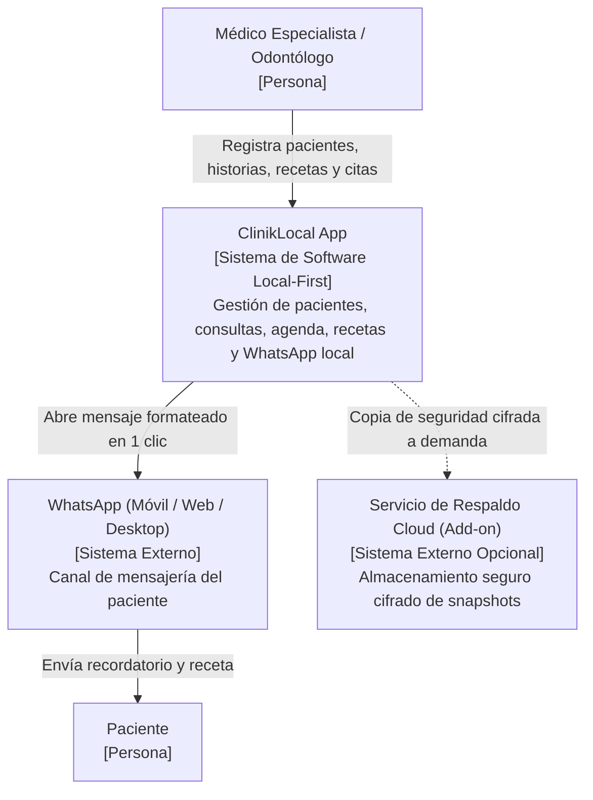
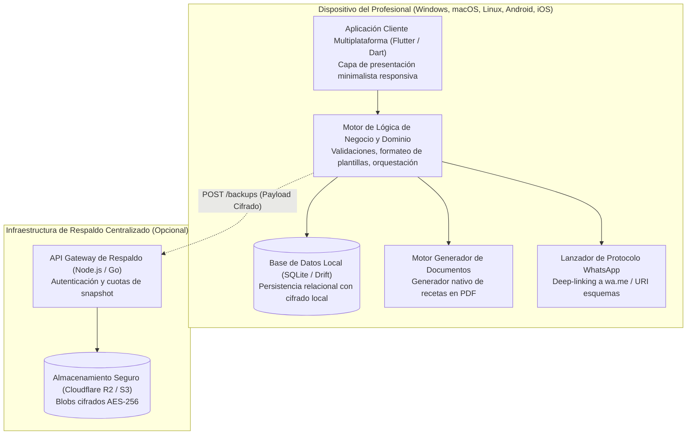
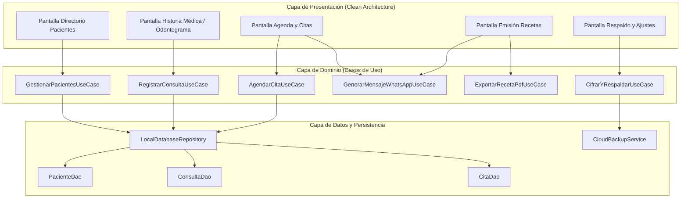
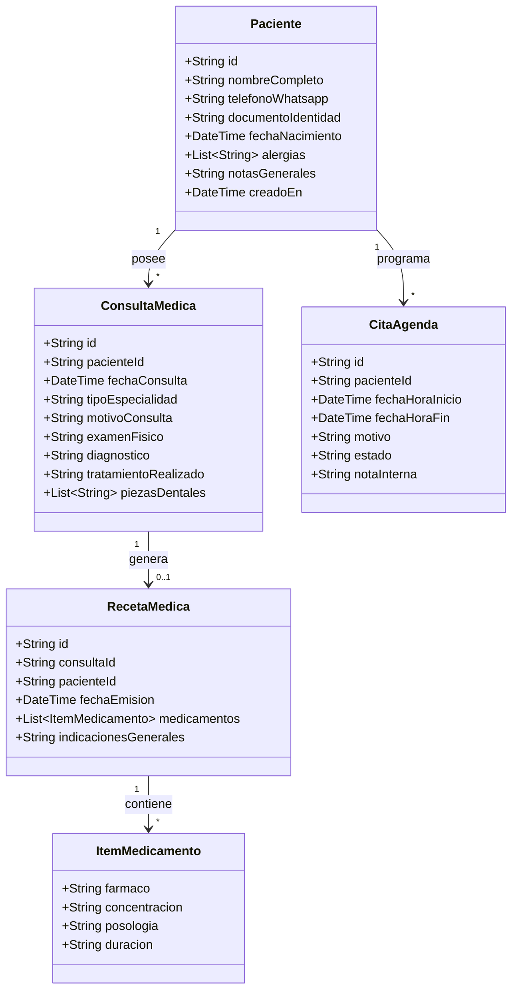
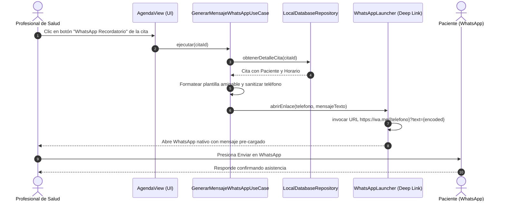

# Arquitectura y Diseño Técnico (C4 Model + ICONIX Process)
## MicroApp 1: ClinikLocal (Gestión Clínica y Dental Local-First)

---

## 1. C4 Model (Visualización Arquitectónica)

### 1.1. Nivel 1: Diagrama de Contexto del Sistema

---

### 1.2. Nivel 2: Diagrama de Contenedores

---

### 1.3. Nivel 3: Diagrama de Componentes (Cliente Local)

---

## 2. Metodología ICONIX

### 2.1. Modelo de Dominio de Datos

---

### 2.2. Diagrama de Secuencia: Recordatorio de Cita por WhatsApp

---

## 3. Patrones de Diseño Aplicados

1. **Clean Architecture (Onion):** Separación rigurosa de Presentación (Widgets reactivos), Dominio (Entidades y Casos de Uso puros) e Infraestructura (SQLite, Launcher, PDF).
2. **Repository Pattern:** Abstracción unificada del acceso a los datos locales para desacoplar el motor SQLite de la lógica de negocio.
3. **Template Method / Strategy Pattern:** Formateo dinámico de plantillas de WhatsApp según el tipo de comunicación (Confirmación de Cita, Recordatorio 24h, Envío de Receta, Indicación Post-Tratamiento).
4. **Zero-Knowledge Encryption Pattern:** Para el módulo de respaldo opcional, la clave secreta derivada de la contraseña del médico se usa para cifrar localmente el archivo antes de cualquier transmisión a la nube.
