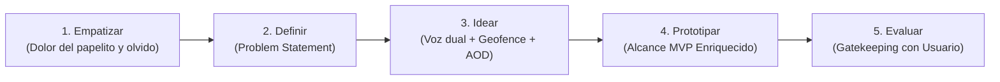
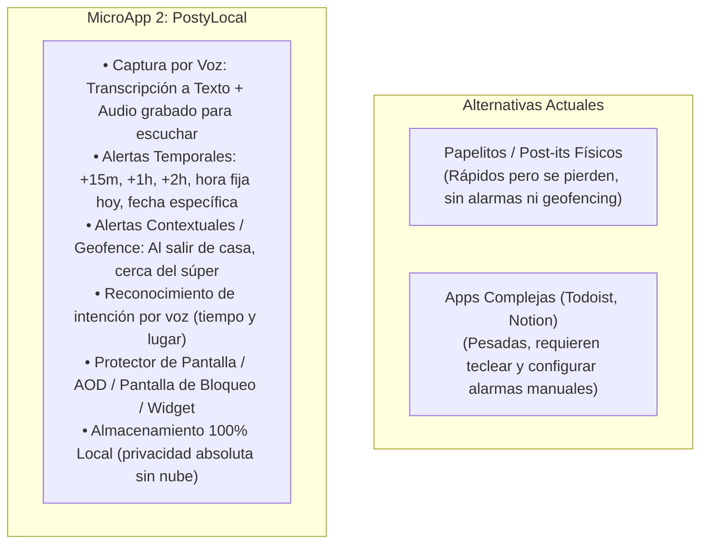

# Documento de Envisioning y Planificación
## MicroApp 2: Recordatorio y Notas Visuales Ultraligeras (Local-First Móvil)

---

## 1. Declaración de Visión

* **Nombre de la Iniciativa:** MicroApp 2 - *PostyLocal* (Recordatorio, Voz y Notas Visuales Inteligentes para Smartphone).
* **Visión del Producto:** Proporcionar a las personas habituadas a usar papelitos, libretas y *post-its* una herramienta móvil ultra-simple, visual y de gestión 100% local, que permita la captura inmediata mediante voz o texto, conserve el audio original para escuchar opcionalmente, priorice visualmente las tareas según su vencimiento diario, emita alertas push temporales (+15m, +1h, +2h, hora fija) y contextuales (geofencing: al salir de casa o al estar cerca del súper), y mantenga visibles las actividades críticas directamente en la pantalla de bloqueo, widget y modo protector de pantalla (*screensaver*).
* **Propósito Estratégico:** Sustituir los papelitos físicos con una experiencia digital sin fricción, autónoma y privada, donde el usuario puede hablarle a su celular en lenguaje natural y tener la certeza de que el pendiente aparecerá en el momento y lugar exacto.

---

## 2. Metodología Design Thinking

### 2.1. Fase 1: Empatizar (Empathize)

#### Contexto y Dolor Real del Usuario
1. **Fricción al escribir en el celular:** En situaciones cotidianas (caminando, manejando, cocinando o saliendo de prisa), detenerse a teclear un recordatorio en una pantalla táctil resulta lento y peligroso; hablarle al teléfono es la forma natural de registrar una idea en segundos.
2. **Pérdida del matiz o contexto sonoro:** Una nota escrita muy corta a veces resulta ambigua horas después; contar con el audio original grabado permite escuchar el tono exacto o detalles secundarios que no se transcribieron.
3. **Alertas que no se ajustan a la vida real:** Muchas tareas no dependen de una hora exacta, sino de una ubicación física (p. ej., *"recordarme comprar leche cuando esté cerca del supermercado"* o *"recordarme apagar la llave del gas al salir de casa"*). Las aplicaciones convencionales suelen exigir configuraciones de mapas engorrosas o no vinculan la voz con la geolocalización.
4. **Dependencia y pérdida del papel físico:** Los *post-its* no avisan, no viajan con la persona fuera de la oficina o casa, y terminan en la basura.
5. **Privacidad y autonomía total:** No enviar datos personales de voz ni ubicaciones GPS a servidores corporativos externos; el procesamiento y resguardo debe ser soberano en el dispositivo (*local-first*).

#### Arquetipos de Usuario (User Personas)

| Arquetipo | Perfil | Necesidad Principal | Dolor Crítico |
| :--- | :--- | :--- | :--- |
| **Usuario Cotidiano en Movimiento** | Profesional, comerciante, estudiante o ama de casa ocupado(a). | Dictar una nota en 3 segundos mientras hace otra actividad y que se cree el recordatorio automáticamente. | No tiene tiempo para escribir; olvida recados porque las notas en papel no están a mano. |
| **Usuario de Mandados y Contexto** | Persona que realiza compras, trámites y visitas en su día a día. | Alertas por cercanía (*"cerca del súper"*) o cambio de contexto (*"al salir de casa"*). | Pasa frente a la tienda y olvida comprar lo necesario; se acuerda al llegar a casa. |
| **Persona Visual y Práctica** | Usuario que prefiere tarjetas grandes de colores y escuchar si tiene dudas. | Tarjeta visible diaria con texto legible en primer término y botón para oír la voz original. | Apps tradicionales frías con texto pequeño y menús densos. |

---

### 2.2. Fase 2: Definir (Define)

#### Problem Statement (Declaración del Problema)
> *"Las personas activas que gestionan sus pendientes en notas de papel y post-its necesitan una solución móvil ultra-sencilla, activada por voz y de gestión local, que transcriba y guarde el audio, emita alertas tanto por tiempo (+15 min, +1h, hora fija) como por contexto geográfico (salir de casa o estar cerca del supermercado), y mantenga visibles los pendientes prioritarios en la pantalla de bloqueo y protector de pantalla, porque escribir en el teclado genera fricción, el papel físico se extravía sin alertar y las aplicaciones convencionales ignoran las alertas por ubicación cotidiana sin configuraciones complejas."*

#### Propuesta de Valor Diferencial

---

### 2.3. Fase 3: Idear (Ideate)

#### Principios de Diseño
1. **Captura Rápida Dual (Voz + Texto + Audio):**
   * El usuario pulsa el micrófono (o botón flotante) y habla libremente: *"Comprar pan en 1 hora"* o *"Comprar medicina cuando esté cerca de la farmacia"*.
   * **Visualización primaria:** Se genera una nota visual tipo post-it con el texto transcrito de alta legibilidad.
   * **Reproducción secundaria:** La nota conserva adjunto el clip de audio original grabado para que el usuario pueda reproducirlo y escucharlo con un toque en cualquier instante.
2. **Sistema Inteligente de Alertas (Temporales y Geográficas):**
   * **Temporales Rápidas:** Selector de 1 toque: `+15 min`, `+1 hora`, `+2 horas`.
   * **Temporales Específicas:** Hora fijada para el día de hoy (p. ej., `18:30`) o selector de fecha y hora futura.
   * **Contextuales (Geofencing Local):**
     * Disparador por abandono de zona: *"Al salir de casa"*.
     * Disparador por proximidad de radio: *"Al estar cerca de..."* (Supermercado, Farmacia, Oficina, etc.).
   * **Detección Automática por Voz:** El reconocedor analiza comandos verbales para preconfigurar el tiempo o lugar sin intervención táctil adicional.
3. **Prioridad Visual Diaria (Semáforo de Relevancia):**
   * 🔴 **Urgente / Vence Hoy o Próxima a disparar:** Tarjeta destacada en cabecera con color llamativo.
   * 🟡 **Próximas (24-48 horas o Geofence activo):** Ubicación intermedia.
   * 🟢 **Pendiente sin plazo estricto:** Visualización tipo tablero libre.
4. **Visibilidad Continua (Protector de Pantalla / Lockscreen / Widget):**
   * **Protector de Pantalla (*Android DreamService*):** Visualización ambiente de pantalla completa en reposo/carga con las 3 actividades más relevantes por cumplirse y su estado de alerta.
   * **Notificación Persistente en Pantalla de Bloqueo:** Notificación viva con las actividades prioritarias del día, accesible sin desbloquear.
   * **Widget de Pantalla de Inicio:** Post-its interactivos en el escritorio del móvil.

---

### 2.4. Fase 4: Prototipado y Alcance del MVP

#### En Alcance (MVP - Versión 1.0)
* **Captura por Voz y Notas Duales:**
  * Grabación de voz en 1 toque con transcripción automática a texto (Speech-to-Text integrado).
  * Almacenamiento local del archivo de audio grabado (.m4a / .aac) para reproducción bajo demanda.
  * Tarjeta visual estilo post-it: lectura rápida en primer término y botón *"Escuchar"* para reproducir la nota sonora.
  * Creación y edición manual de texto con selección de colores temáticos (amarillo, menta, azul cielo, rosa coral, lavanda).
* **Motor de Alertas Flexibles:**
  * **Alertas de Tiempo Relativo:** Presets rápidos `+15m`, `+1h`, `+2h`.
  * **Alertas de Tiempo Absoluto:** Hora específica de hoy y fecha/hora programada.
  * **Alertas Geográficas Locales (Geofencing):** Radio de cercanía configurado localmente (*"Cerca del súper"*, *"Al salir de casa"*) activando notificación push local al entrar o salir del área.
  * **Parser de Voz para Alertas:** Detección en lenguaje natural de parámetros de tiempo (*"en 15 minutos"*, *"a las 5 de la tarde"*) y ubicación (*"al salir de casa"*, *"en el súper"*).
* **Organización y Relevancia Diaria:**
  * Tablero del día con orden dinámico por proximidad de cumplimiento.
  * Semáforo visual de urgencia.
* **Integración con Sistema Operativo Móvil:**
  * Notificaciones Push locales del smartphone (sonido, vibración y acciones rápidas).
  * Modo Protector de Pantalla (*Android Screensaver / DreamService*) con vista nocturna/OLED optimizada.
  * Notificación fija / Widget en pantalla de bloqueo.
* **Arquitectura Local-First:**
  * Almacenamiento 100% en el dispositivo (SQLite / Isar / Hive local), cero telemetría externa, privacidad garantizada y funcionamiento sin conexión a internet.

#### Fuera de Alcance (Fases Posteriores)
* Registro obligatorio de usuarios, contraseñas o login con redes sociales.
* Servidor centralizado y sincronización en la nube multi-dispositivo.
* Modelos de suscripción de pago o cobros in-app.
* Integración con calendarios corporativos de terceros (Google Calendar, Outlook).
* OCR de documentos PDF extensos (se mantiene enfocado en notas y recordatorios directos).

---

## 3. Factibilidad Técnica e Integraciones Reales

* **Framework de Aplicación Móvil:** Flutter (utilizado y validado en `plataforma01`, con soporte nativo para Android e iOS).
* **Captura de Voz y Audio:**
  * `speech_to_text`: Reconocimiento de voz local/dispositivo para transcripción directa sin latencia.
  * `record` o `flutter_sound`: Grabación de audio ligera con compresión AAC/M4A almacenada en el directorio local de la app.
  * `audioplayers` o `just_audio`: Reproducción fluida del audio grabado desde la propia tarjeta visual.
* **Alertas Push y Programación Temporal:**
  * `flutter_local_notifications`: Disparo de alarmas exactas con `AlarmManager` en Android, funcionando en segundo plano sin servidores externos.
* **Alertas de Geofencing / Ubicación Local:**
  * `geolocator` y `geofence_service` (Android `GeofencingClient`): Monitoreo de bajo consumo de batería para detección de entrada/salida de geocercas predefinidas (Casa, Supermercado, Trabajo) de forma local.
* **Parser de Lenguaje Natural Local:**
  * Expresiones regulares y reglas semánticas ligeras en Dart para extraer entidades temporales (*"en 15 minutos"*, *"a las 16:00"*) y contextuales (*"cerca de..."*, *"al salir de..."*).
* **Protector de Pantalla / Lockscreen:**
  * Implementación nativa de `DreamService` en la capa Android (`MainActivity` / servicio nativo en Kotlin) invocado por el sistema de protector de pantalla de Android.
  * Notificación persistente con categoría `CATEGORY_STATUS` / `ongoing: true` para visibilidad en pantalla de bloqueo y AOD (Always-On-Display).
* **Persistencia Local:**
  * SQLite (`sqflite`) para registros estructurados de notas, estados, coordenadas y enlaces a archivos de audio.

---

## 4. Roadmap y Cronograma de Fases SDLC

| Hito | Fase SDLC | Entregable Principal | Estado |
| :--- | :--- | :--- | :--- |
| **M1** | **Envisioning & Planning** | Documento de Visión, Design Thinking y Alcance MVP con Voz y Geofencing (`01_envisioning_and_planning.md`) | **En Validación (Actual)** |
| **M2** | **Análisis de Requisitos** | Especificación formal de Requisitos IEEE 830: RF de Voz, Audio, Geofencing, Push y AOD (`02_requirements_ieee830.md`) | Pendiente de Aprobación M1 |
| **M3** | **Análisis y Diseño** | C4 Model (Contexto, Contenedores, Componentes) y Modelo ICONIX de los flujos de voz, ubicación y widgets | Pendiente de Aprobación M2 |
| **M4** | **Desarrollo e Implementación** | 4.1 Stack Tecnológico, 4.2 Maquetación UI de Post-its, 4.3 Core XP/TDD de audio/alarmas, 4.4 Build local | Pendiente de Aprobación M3 |
| **M5** | **Pruebas y QA** | Pruebas unitarias de parser, pruebas de disparo de alarmas (+15m, geocercas) y playback de audio | Pendiente de Aprobación M4 |
| **M6** | **Despliegue y Release** | Generación de APK Android firmado, guía de permisos (Micrófono, Ubicación, Alarmas) y cierre GitFlow | Pendiente de Aprobación M5 |

---

## 5. Control de Puerta de Calidad (Quality Gate)

* **Documento Actualizado:** `docs/microapps/microapp2/01_envisioning_and_planning.md`
* **Rama GitFlow Activa:** `feature/microapp2-01-envisioning`
* **Issue GitHub Asignado:** `#30` (Asignado a `pcloayza3` en estado `In Progress`)
* **Estado:** Actualización formal completada con los requerimientos de voz dual y alertas temporales/geográficas.
