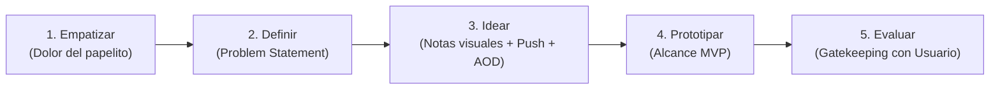
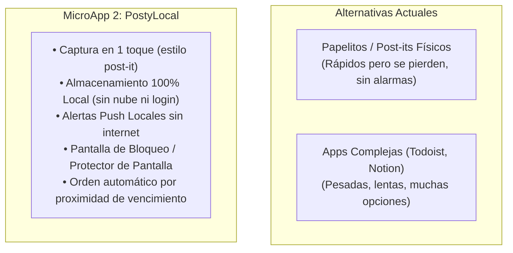

# Documento de Envisioning y Planificación
## MicroApp 2: Recordatorio y Notas Visuales Ultraligeras (Local-First Móvil)

---

## 1. Declaración de Visión

* **Nombre de la Iniciativa:** MicroApp 2 - *PostyLocal* (Recordatorio y Notas Visuales Diarias para Smartphone).
* **Visión del Producto:** Ofrecer a las personas que dependen de notas en papel, libretas y *post-its* una herramienta móvil ultra-simple, ágil y de gestión 100% local, que elimine la fricción de anotar, priorice visualmente las tareas según su vencimiento diario, emita alertas push locales y mantenga visibles las actividades críticas directamente en la pantalla de bloqueo, widget y modo protector de pantalla (*screensaver*).
* **Propósito Estratégico:** Sustituir el caos de los papelitos físicos con una experiencia digital sin fricción, sin cuentas ni registros obligatorios, garantizando funcionamiento sin internet y máxima visibilidad de los pendientes críticos.

---

## 2. Metodología Design Thinking

### 2.1. Fase 1: Empatizar (Empathize)

#### Contexto y Dolor Real del Usuario
1. **Fricción de las apps complejas:** La mayoría de las aplicaciones de gestión de tareas (Notion, Todoist, Asana, Google Keep) incorporan jerarquías complejas (proyectos, carpetas, etiquetas anidadas, fechas recurrentes avanzadas) que desmotivan al usuario común.
2. **Dependencia del papel físico:** Muchas personas siguen usando *post-its* en su monitor, refrigerador o libreta porque escribir toma 3 segundos y queda a la vista inmediata. Sin embargo, el papel no emite alarmas, se pierde, se moja o se olvida en casa/oficina.
3. **Falta de visibilidad proactiva:** En una app tradicional, si el usuario no abre la aplicación activamente, la tarea se olvida. Se requiere que el móvil muestre las tareas prioritarias en su estado de reposo o pantalla de bloqueo.
4. **Privacidad y dependencia de conexión:** Muchas herramientas exigen iniciar sesión con correo, suscripciones mensuales o conexión constante a internet, exponiendo recordatorios personales en la nube.

#### Arquetipos de Usuario (User Personas)

| Arquetipo | Perfil | Necesidad Principal | Dolor Crítico |
| :--- | :--- | :--- | :--- |
| **Usuario Cotidiano "Fan del Post-it"** | Profesional, comerciante, estudiante o ama de casa que anota todo en papelitos sueltos. | Anotar un recordatorio en menos de 5 segundos y verlo de inmediato durante el día. | Los papeles se extravían o se quedan sobre el escritorio; no hay recordatorio auditivo. |
| **Profesional Multitarea** | Emprendedor o trabajador con múltiples pequeñas tareas críticas en la jornada. | Identificar al instante qué tarea vence en las próximas horas sin navegar menús. | Olvido de pagos de servicios, llamadas urgentes o entregas por no revisar la app de notas. |
| **Persona Visual y Práctica** | Usuario que prefiere tarjetas de colores grandes y claras sobre listas de texto aburridas. | Vista limpia diaria con código de colores según urgencia y visualización sin desbloquear. | Sobrecarga cognitiva con interfaces densas y botones innecesarios. |

---

### 2.2. Fase 2: Definir (Define)

#### Problem Statement (Declaración del Problema)
> *"Las personas que gestionan sus tareas en papelitos, libretas y post-its necesitan una solución móvil ultra-sencilla, visual e inmediata para anotar pendientes y recordarlos a tiempo, porque las aplicaciones actuales son complejas de usar, exigen cuentas y conexión permanente, y las notas en papel se extravían con facilidad y no emiten alertas proactivas ni son visibles en los momentos de reposo del celular."*

#### Propuesta de Valor Diferencial

---

### 2.3. Fase 3: Idear (Ideate)

#### Principios de Diseño
1. **Regla de los 3 Segundos:** Crear una nueva nota debe requerir máximo 2 toques: pulsar botón y escribir.
2. **Prioridad Visual Diaria (Semáforo de Relevancia):**
   * 🔴 **Urgente / Vence Hoy:** Destacada en la parte superior con tarjeta resaltada.
   * 🟡 **Próxima (24-48 horas):** Posición intermedia.
   * 🟢 **Normal / Sin fecha estricta:** Base del tablero estilo tablero de corcho/post-its.
3. **Visibilidad Continua (Protector de Pantalla / Lockscreen / Widget):**
   * **Modo Protector de Pantalla (Android DreamService):** Cuando el teléfono se coloca en carga o reposo, se activa una visualización atenuada tipo reloj/ambiente que exhibe las 3 tareas más relevantes por cumplirse.
   * **Notificación Persistente / Widget de Pantalla de Bloqueo:** Notificación silenciosa anclada en el centro de notificaciones y pantalla de bloqueo para consultar pendientes sin desbloquear el dispositivo.
4. **Alertas Push del Smartphone:**
   * Notificaciones locales programadas en el sistema operativo del teléfono con sonido y vibración configurable, funcionando en segundo plano sin consumir servidor externo.

---

### 2.4. Fase 4: Prototipado y Alcance del MVP

#### En Alcance (MVP - Versión 1.0)
* **Gestión de Notas Visuales:**
  * Crear, editar, marcar como cumplida y archivar/eliminar notas.
  * Selección de color temático tipo post-it (amarillo clásico, azul pastel, verde menta, coral rosa, lavanda).
  * Asignación opcional de fecha y hora de vencimiento.
* **Organización y Relevancia Diaria:**
  * Vista principal "Día de Hoy": notas activas filtradas y ordenadas por cercanía al vencimiento.
  * Semáforo visual de urgencia.
* **Alertas Push Locales:**
  * Programación de notificación push en el celular a la hora exacta estipulada.
  * Acciones rápidas desde la notificación (p. ej., "Completar" o "Posponer 15 min").
* **Modo Protector de Pantalla / Visualización Ambiente:**
  * Modo pantalla completa de visualización ambiental (Protector de pantalla / Clock & Tasks View) con contraste optimizado para pantallas OLED/AMOLED.
  * Widget para pantalla de inicio y notificación persistente en pantalla de bloqueo.
* **Almacenamiento Local-First:**
  * Base de datos local embebida en el dispositivo (cero telemetría obligatoria, privacidad absoluta, respaldo local JSON/exportación).

#### Fuera de Alcance (Fases Posteriores)
* Registro obligatorio de usuarios y autenticación con contraseñas.
* Servidor centralizado y sincronización en la nube multi-dispositivo.
* Subscripciones de pago dentro de la app (se abordará en fase comercial posterior).
* Integración con Microsoft Teams, Jira o calendarios de terceros.
* Reconocimiento de voz / OCR de notas físicas (candidato a versión 2.0).

---

## 3. Factibilidad Técnica e Integraciones Reales

* **Entorno de Ejecución:** Aplicación Móvil Híbrida / Nativa (Flutter o React Native / Capacitor Android).
  * Flutter es la tecnología ya adoptada exitosamente en la iniciativa *ClinikLocal* del proyecto `plataforma01`, permitiendo reutilizar tooling, build scripts y empaquetado APK.
* **Mecanismos para "Protector de Pantalla y Pantalla de Bloqueo":**
  1. **Android DreamService (Screensaver Nativo):** API oficial de Android (`android.service.dreams.DreamService`) que se activa automáticamente al cargar el dispositivo o colocarlo en base, mostrando las tareas del día.
  2. **Notificación Persistente de Pantalla de Bloqueo:** Notificación local de tipo `Ongoing` con prioridad alta para que permanezca visible en la pantalla de bloqueo y Always-On-Display (AOD).
  3. **Android Home/Lock Screen Widget:** Widget interactivo de tareas con actualización local.
* **Mecanismo de Alertas Push Locales:**
  * Paquete de notificaciones locales nativas (`flutter_local_notifications` en Android/iOS) que programa alarmas exactas usando el `AlarmManager` del sistema operativo sin depender de servidores push en la nube (FCM / APNs) ni requerir internet.
* **Persistencia Local:**
  * Almacenamiento rápido en SQLite (`sqflite`) o base de datos clave-valor de alto rendimiento (`hive` / `isar`), garantizando lectura en menos de 5 milisegundos.

---

## 4. Roadmap y Cronograma de Fases SDLC

| Hito | Fase SDLC | Entregable Principal | Estado |
| :--- | :--- | :--- | :--- |
| **M1** | **Envisioning & Planning** | Documento de Visión, Design Thinking y Alcance MVP (`01_envisioning_and_planning.md`) | **En Validación (Actual)** |
| **M2** | **Análisis de Requisitos** | Especificación formal de Requisitos de Software bajo estándar IEEE 830 (`02_requirements_ieee830.md`) | Pendiente de Aprobación M1 |
| **M3** | **Análisis y Diseño** | Arquitectura C4 Model (Contexto, Contenedores, Componentes) y Modelo ICONIX (`03_architecture_and_design.md`) | Pendiente de Aprobación M2 |
| **M4** | **Desarrollo e Implementación** | 4.1 Stack Tecnológico, 4.2 Maquetación UI, 4.3 Implementación Core XP/TDD, 4.4 Build local | Pendiente de Aprobación M3 |
| **M5** | **Pruebas y QA** | Pruebas unitarias, pruebas de notificaciones locales, visualización widget/saver | Pendiente de Aprobación M4 |
| **M6** | **Despliegue y Release** | Empaquetado APK Android, documentación de instalación y cierre GitFlow | Pendiente de Aprobación M5 |

---

## 5. Control de Puerta de Calidad (Quality Gate)

* **Documento Generado:** `docs/microapps/microapp2/01_envisioning_and_planning.md`
* **Rama GitFlow Activa:** `feature/microapp2-01-envisioning`
* **Issue GitHub Asignado:** `#30` (Asignado a `pcloayza3` en estado `In Progress`)
* **Estado:** Completado borrador para revisión y validación expresa del usuario.
