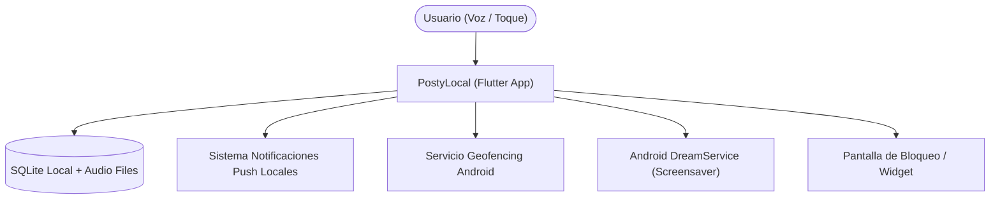

# Especificación de Requisitos de Software (SRS) - IEEE 830
## MicroApp 2: Recordatorio y Notas Visuales Inteligentes (*PostyLocal*)

---

## 1. Introducción

### 1.1. Propósito
El propósito de este documento es especificar de manera formal, completa y verificable los requisitos funcionales y no funcionales de la **MicroApp 2 (*PostyLocal*)**, bajo el estándar internacional **IEEE 830**. Este documento sirve como contrato técnico de referencia para las fases de arquitectura, diseño e implementación con Extreme Programming (XP / TDD).

### 1.2. Alcance del Sistema
* **Nombre del Producto:** *PostyLocal* (v1.0.0).
* **Objetivo:** Proporcionar una experiencia móvil ultra-ágil para captura y consulta de recordatorios diarios, reemplazando el uso de papelitos y *post-its* físicos mediante:
  1. Captura por voz que transcribe a texto legible y conserva el audio original para escuchar opcionalmente.
  2. Alertas temporales rápidas (+15m, +1h, +2h, hora fija) y alertas contextuales por geofencing ("al salir de casa", "cerca del supermercado").
  3. Visualización persistente en pantalla de bloqueo, widgets y modo protector de pantalla (*Android DreamService*).
  4. Gestión y persistencia 100% local (*Local-First*), sin cuentas, sin login obligatorio y sin telemetría en la nube.

### 1.3. Definiciones, Acrónimos y Abreviaturas
* **Local-First:** Paradigma de software donde los datos residen íntegramente en el dispositivo del usuario sin requerir servidores remotos para su funcionamiento.
* **STT (Speech-to-Text):** Conversión de señal de voz acústica a texto legible mediante motores del sistema operativo.
* **Geofencing:** Delimitación de un perímetro geográfico virtual que detona eventos al entrar o salir de sus coordenadas.
* **DreamService / Screensaver:** Servicio nativo del sistema operativo Android que dibuja contenido visual interactivo cuando el terminal se coloca en carga o reposo.
* **AOD (Always-On-Display):** Pantalla ambiente en dispositivos OLED donde se muestran notificaciones de baja emisión lumínica.
* **SRS:** Software Requirements Specification (Especificación de Requisitos de Software).

### 1.4. Referencias y Fuentes Reales
* **IEEE Std 830-1998:** IEEE Recommended Practice for Software Requirements Specifications.
* **Android Developers Guide:** `android.service.dreams.DreamService` y `androidx.work.WorkManager`.
* **Google Play Services Location:** Documentación oficial de Geofencing API para bajo consumo de batería.
* **Flutter Documentation:** `speech_to_text`, `record`, `audioplayers`, `flutter_local_notifications` y `sqflite`.

---

## 2. Descripción General

### 2.1. Perspectiva del Producto
*PostyLocal* es una aplicación móvil autónoma, autocontenida y complementaria al ecosistema de micro-aplicaciones de productividad de `plataforma01`. No depende de pasarelas de pago externas ni de bases de datos centralizadas en la nube para su operativa esencial.



### 2.2. Funciones Principales del Software
1. **Captura por Voz Dual:** Transcribe a texto inmediato para lectura rápida y almacena el audio original para escucha facultativa.
2. **Interpretación Inteligente:** Extracción sintáctica local de instrucciones de tiempo y geolocalización a partir de la voz.
3. **Tablero Visual Diario:** Exhibición de notas en formato de tarjetas de colores con jerarquía visual según urgencia.
4. **Despacho de Alertas Híbridas:** Alertas por tiempo transcurrido, hora fija o por entrada/salida de geocercas preconfiguradas.
5. **Modo Protector de Pantalla y Lockscreen:** Despliegue de los pendientes críticos en reposo, carga o pantalla de bloqueo.

### 2.3. Características de los Usuarios
* **Usuario Final:** Persona habituada a registrar notas en papelitos que busca máxima rapidez (≤ 3 segundos), cero fricción de registro y privacidad absoluta. No se requieren conocimientos técnicos avanzados.

### 2.4. Restricciones Generales
1. **Autonomía Offline Mandatoria:** Todas las capacidades esenciales (notas, audios, alarmas, geofence) deben operar sin conexión activa de datos ni WiFi.
2. **Eficiencia Energética:** El geofencing debe utilizar proveedores de ubicación balanceados (red móvil y WiFi) sin mantener el GPS activo de forma continua.
3. **Restricción de Privacidad:** Prohibido el envío de grabaciones de voz o coordenadas geográficas a servicios analíticos de terceros.

---

## 3. Requisitos Específicos

### 3.1. Requisitos Funcionales (RF)

| ID | Título | Descripción Detallada | Entradas | Procesamiento | Salidas | Criterio de Aceptación |
| :--- | :--- | :--- | :--- | :--- | :--- | :--- |
| **RF-01** | Captura por Voz (STT) | Grabar entrada de voz del usuario y transcribirla automáticamente a texto en la tarjeta. | Señal de audio del micrófono. | Reconocimiento fonético local mediante API STT del dispositivo. | Texto transcrito editable en la tarjeta visual. | Transcripción en menos de 1.5s con precisión fonética en español. |
| **RF-02** | Almacenamiento de Audio Original | Guardar el archivo sonoro dictado en formato ligero comprimido (.m4a/.aac). | Flujo de audio del micrófono. | Codificación AAC a 64 kbps mono y guardado en almacenamiento privado de la app. | Archivo local vinculado al ID de la nota. | Archivo de audio íntegro de menos de 100 KB para dictados de 15 segundos. |
| **RF-03** | Visualización Dual y Reproductor | Mostrar texto en primer término y proveer control de reproducción de audio. | Toque en botón de reproducción. | Carga del audio local mediante reproductor integrado con indicador de progreso. | Emisión de sonido por altavoz o auriculares. | Reproducción inmediata (< 200ms) con controles de Play, Pausa y Barra de avance. |
| **RF-04** | Creación y Edición Manual | Permitir la captura y ajuste manual del texto con selección de colores temáticos de notas adhesivas. | Texto ingresado por teclado y selección de color (amarillo, menta, azul, coral, lavanda). | Validación de longitud (máx. 280 caracteres por post-it) y asignación estética. | Nota guardada en la base de datos local. | Creación completada en máximo 2 toques. |
| **RF-05** | Alertas Temporales Rápidas y Fijas | Programar alarmas locales con presets (+15m, +1h, +2h) o fecha/hora exacta. | Selección táctil o comando de voz temporal. | Cálculo del timestamp Unix y registro en `AlarmManager` / `zonedSchedule`. | Alarma programada en el sistema operativo. | Disparo de la alerta con tolerancia temporal menor a 15 segundos en modo reposo. |
| **RF-06** | Alertas Contextuales por Geofencing | Notificar al usuario al entrar o salir de zonas predefinidas (ej. Casa, Supermercado). | Ubicación seleccionada (radio de 150m) y tipo de evento (entrada/salida). | Registro de geocerca en el cliente nativo de ubicación; monitoreo pasivo de transiciones. | Disparo de alerta push al cruzar el perímetro virtual. | La notificación push se activa dentro de los primeros 60 segundos tras cruzar el radio. |
| **RF-07** | Parser de Intención de Voz | Analizar el texto transcrito para inferir automáticamente parámetros de tiempo y ubicación. | Cadena de texto resultante del STT. | Expresiones regulares y reglas sintácticas para extraer horarios, deltas temporales y lugares. | Objeto de configuración de alerta prellenado automáticamente. | Detección exitosa de patrones como *"en 15 minutos"*, *"a las 5pm"* y *"cerca del súper"*. |
| **RF-08** | Tablero Diario de Relevancia | Presentar las notas activas ordenadas por urgencia con código de semáforo visual. | Lista de notas activas en SQLite. | Ordenamiento por cercanía de vencimiento y estado de geocerca (Rojo: < 2h / Vence hoy, Amarillo: 24-48h, Verde: Libre). | Grid visual responsivo tipo post-its con insignias de urgencia. | Carga instantánea (< 100ms para 100 notas) con actualización en tiempo real. |
| **RF-09** | Despacho de Notificaciones Push Locales | Desplegar alerta push nativa con sonido, vibración y botones de acción rápida. | Evento detonado por alarma o geocerca. | Construcción de notificación de alta prioridad con botones *"Completar"* y *"Posponer 15m"*. | Notificación emergente en el smartphone y pantalla de bloqueo. | La acción *"Completar"* marca la nota como lista sin necesidad de abrir la aplicación completa. |
| **RF-10** | Modo Protector de Pantalla (Screensaver) | Proporcionar una pantalla ambiente nocturna/OLED cuando el celular reposa o carga. | Activación del protector de pantalla de Android (`DreamService`) o botón manual. | Consulta de las 3 notas más urgentes del día y renderizado minimalista de alto contraste. | Pantalla de protector atenuada con reloj y actividades pendientes. | Cero consumo de servidor y actualización dinámica de pendientes sin agotar pantalla. |
| **RF-11** | Respaldo y Exportación Local | Permitir exportar e importar las notas y referencias de audio en archivo local JSON/ZIP. | Solicitud de exportación o importación de archivo. | Serialización de la base de datos SQLite y empaquetado de archivos de audio. | Archivo de respaldo descargable en la carpeta local del dispositivo. | Restauración 100% consistente de notas, colores y clips de audio. |

---

### 3.2. Requisitos No Funcionales (RNF)

| ID | Categoría | Requisito Específico | Métrica de Medición Cuantificable |
| :--- | :--- | :--- | :--- |
| **RNF-01** | **Rendimiento** | Latencia de inicio de la aplicación en frío y renderizado de la vista de notas. | Tiempo de arranque frío ≤ 1.2 segundos; renderizado de notas ≤ 80 milisegundos. |
| **RNF-02** | **Eficiencia de Almacenamiento** | Huella de almacenamiento de notas y archivos de audio en el teléfono. | Tamaño base de app ≤ 25 MB; audio comprimido AAC ≤ 100 KB por nota de voz de 15s. |
| **RNF-03** | **Eficiencia de Batería** | Impacto energético del servicio de geofencing en segundo plano. | Consumo de batería atribuible al servicio de geofencing ≤ 2.5% diario en uso típico. |
| **RNF-04** | **Privacidad y Seguridad** | Soberanía total de datos personales, audios y coordenadas. | 0 bytes transmitidos a servidores de telemetría; almacenamiento local en sandbox privado. |
| **RNF-05** | **Disponibilidad Offline** | Funcionalidad completa sin red móvil ni WiFi. | 100% de operaciones funcionales ejecutables en modo avión. |
| **RNF-06** | **Usabilidad Móvil** | Accesibilidad ergonómica para interacción con una sola mano. | Botones de acción táctiles ≥ 48x48 dp; contraste tipográfico compatible con WCAG 2.1 nivel AA. |

---

## 4. Criterios de Aceptación (Formato Given-When-Then)

### Escenario 1: Creación de Nota por Voz con Alerta Temporal
```gherkin
Dado que el usuario tiene la aplicación abierta en su pantalla principal
Cuando presiona el botón del micrófono y dicta "Comprar pan y leche en 15 minutos"
Entonces el sistema transcribe "Comprar pan y leche" en una tarjeta visual de notas
Y almacena el clip de voz grabado con opción de reproducción audible
Y programa automáticamente una notificación push local para detonar dentro de exactamente 15 minutos.
```

### Escenario 2: Alerta Geográfica por Salida de Casa
```gherkin
Dado que el usuario tiene una nota activa "Cerrar la llave de paso" asociada a la geocerca "Casa" (modo: al salir)
Cuando el dispositivo móvil detecta la transición de salida del perímetro de 150 metros de su hogar
Entonces el sistema emite una notificación push de alta prioridad con sonido y vibración
Y muestra la nota destacada en la pantalla de bloqueo con el botón rápido "Completar".
```

### Escenario 3: Activación del Protector de Pantalla (Screensaver)
```gherkin
Dado que el usuario coloca el smartphone en su base de carga o activa el protector de pantalla
Cuando el sistema Android invoca el servicio de protector de pantalla (DreamService)
Entonces se despliega una interfaz de fondo negro puro atenuada mostrando la hora actual
Y las 3 actividades más urgentes por cumplirse ordenadas cronológicamente con su código de color.
```

---

## 5. Matriz de Trazabilidad

| Objetivo Estratégico (Envisioning) | Requisitos Funcionales (RF) | Requisitos No Funcionales (RNF) |
| :--- | :--- | :--- |
| **Captura Rápida sin Fricción** | RF-01, RF-02, RF-04, RF-07 | RNF-01, RNF-06 |
| **Doble Modalidad (Lectura + Escucha)** | RF-02, RF-03 | RNF-02, RNF-06 |
| **Alertas Temporales y Contextuales** | RF-05, RF-06, RF-07, RF-09 | RNF-03, RNF-05 |
| **Visibilidad Diaria Continua** | RF-08, RF-10 | RNF-01, RNF-06 |
| **Soberanía y Privacidad Local-First** | RF-11 | RNF-04, RNF-05 |

---

## 6. Control de Calidad y Verificación

* **Documento Técnico:** `docs/microapps/microapp2/02_requirements_ieee830.md`
* **Rama GitFlow:** `feature/microapp2-02-requirements`
* **Issue Kanban:** `#31` (Asignado a `pcloayza3` en estado `In Progress`)
* **Estado:** Borrador completo conforme a la norma IEEE 830 para validación y aprobación formal del usuario.
