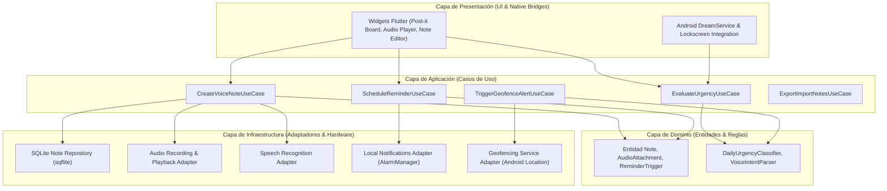
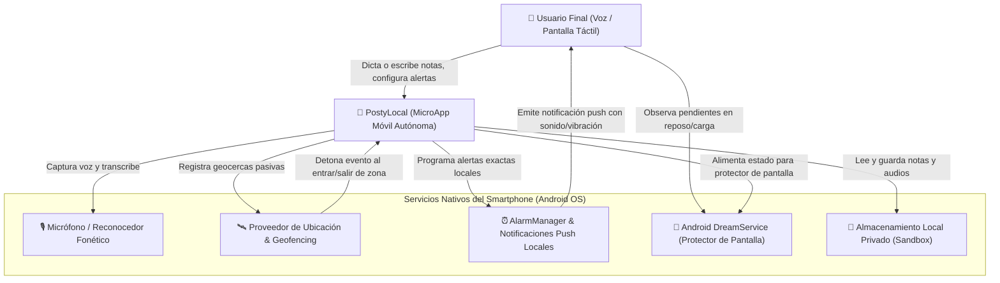
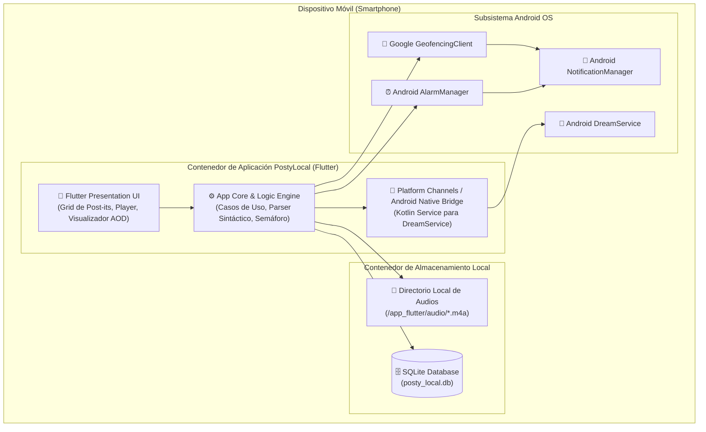
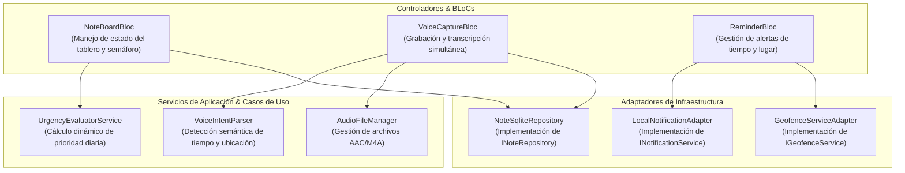
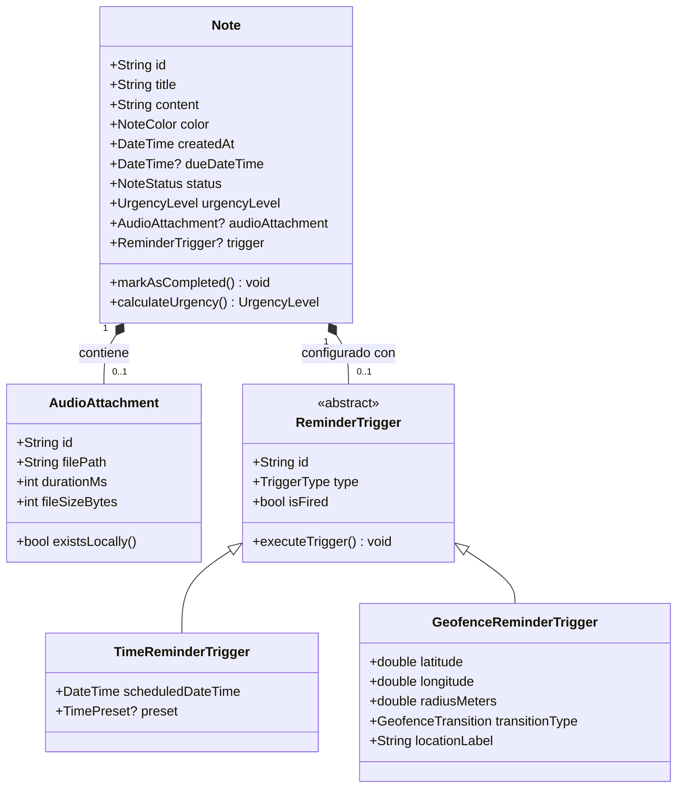
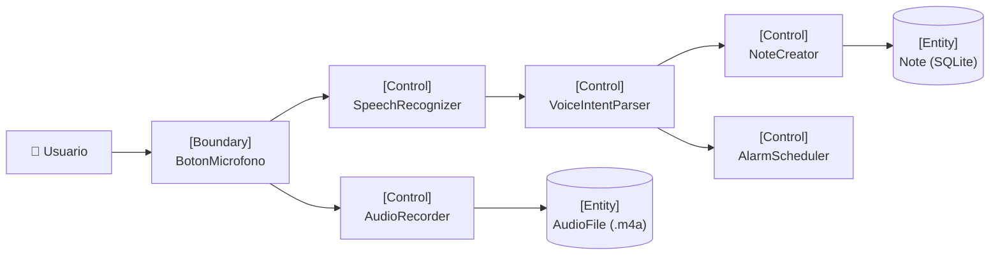
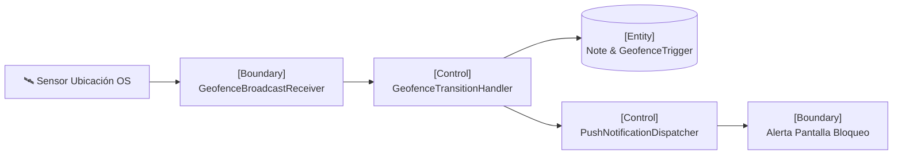
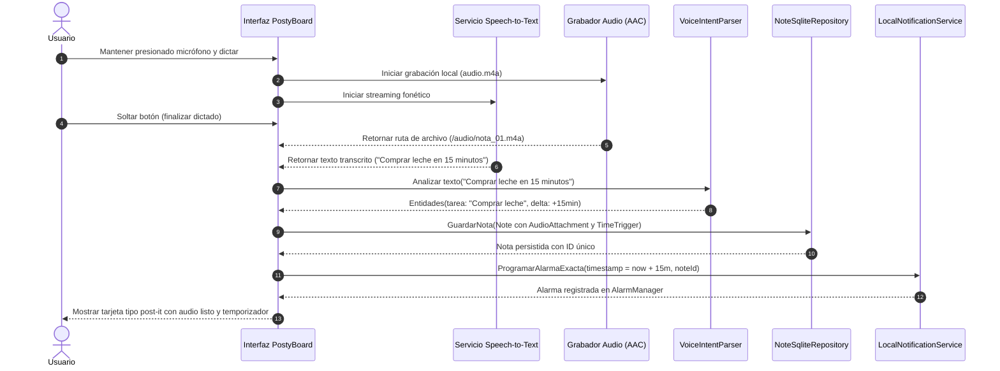
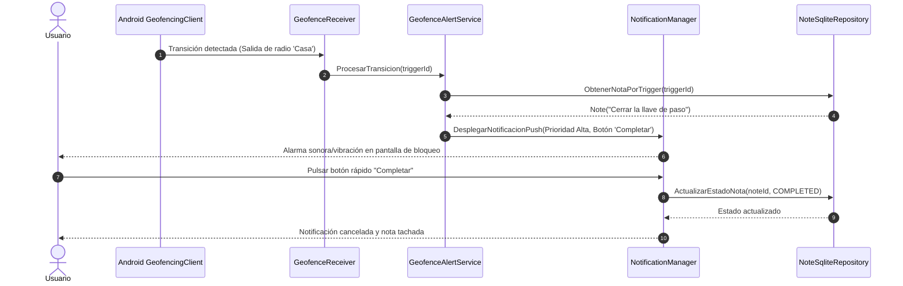

# Documento de Arquitectura y Diseño de Software (C4 Model + ICONIX)
## MicroApp 2: Recordatorio y Notas Visuales Inteligentes (*PostyLocal*)

---

## 1. Patrón Arquitectónico Seleccionado

* **Patrón:** **Clean Architecture Local-First** (Arquitectura Limpia con orientación a datos locales).
* **Justificación Técnica:**
  * **Independencia de Frameworks y Hardware:** La lógica de negocio (priorización de tareas, cálculo del semáforo de urgencia, parsing sintáctico de voz y reglas de recordatorio) queda completamente desacoplada de los plugins de Android (`speech_to_text`, `record`, `geolocator`, `flutter_local_notifications`).
  * **Facilidad de Pruebas Unitarias (XP / TDD):** Permite probar el 100% de los casos de uso y algoritmos mediante pruebas unitarias rápidas utilizando repositorios y servicios simulados en memoria (Mock/In-Memory), sin necesidad de levantar emuladores ni depender de hardware físico de sensores.
  * **Soberanía y Privacidad Absoluta:** La capa de infraestructura garantiza que toda la persistencia se realice en SQLite local y en el sistema de archivos privado del dispositivo (*sandbox*), sin fugas hacia servidores en la nube.

---

## 2. C4 Model (Visualización Arquitectónica Estática)

### 2.1. C4 - Nivel 1: Diagrama de Contexto del Sistema
Representa los límites del sistema *PostyLocal*, sus actores y los servicios nativos del smartphone con los que interactúa.

---

### 2.2. C4 - Nivel 2: Diagrama de Contenedores
Desglose de los componentes de ejecución dentro del dispositivo móvil.

---

### 2.3. C4 - Nivel 3: Diagrama de Componentes (App Core & Logic Engine)
Estructura modular interna del núcleo de la aplicación.

---

### 2.4. C4 - Nivel 4: Código y Modelos Estructurales

---

## 3. Metodología ICONIX (Diseño Dinámico)

### 3.1. Modelo de Dominio
El modelo encapsula el concepto de "Nota Adhesiva Inteligente":
* **Note:** Entidad principal que representa un post-it virtual.
* **AudioAttachment:** Objeto de valor/entidad que representa el audio capturado con voz natural.
* **ReminderTrigger:** Estrategia abstracta que soporta alarmas basadas en tiempo (`TimeReminderTrigger`) o en contexto geográfico (`GeofenceReminderTrigger`).
* **UrgencyLevel:** Enumeración que gobierna el semáforo visual:
  * `URGENT_TODAY` (Rojo: vence hoy o en < 2 horas).
  * `UPCOMING` (Amarillo: vence en 24-48 horas o geocerca armada).
  * `NORMAL` (Verde: sin vencimiento inminente).

---

### 3.2. Análisis de Robustez (Robustness Diagrams)

#### Caso de Uso 1: Captura por Voz Dual (Texto + Audio + Auto-Alerta)
Conecta la interfaz del micrófono con los objetos de negocio y persistencia.

#### Caso de Uso 2: Detección de Geocerca ("Al salir de casa" / "Cerca del súper")
Monitoreo pasivo y emisión de notificación sin intervención manual.

---

### 3.3. Diagramas de Secuencia

#### Secuencia 1: Dictado, Transcripción y Auto-Alarma

#### Secuencia 2: Detonación de Geocerca y Acción Rápida "Completar"

---

## 4. Patrones de Diseño de Software (GoF) Aplicados

| Patrón (GoF) | Ubicación | Justificación Técnica |
| :--- | :--- | :--- |
| **Repository Pattern** | `domain/repositories/i_note_repository.dart` | Aísla completamente las operaciones CRUD de base de datos SQLite de la lógica de presentación y casos de uso. |
| **Strategy Pattern** | `domain/triggers/reminder_strategy.dart` | Permite procesar de manera uniforme alarmas temporales (`TimeStrategy`) y geográficas (`GeofenceStrategy`) bajo una misma interfaz de disparo. |
| **Observer Pattern** | `presentation/blocs/` (BLoC Streams) | Notifica de forma reactiva a la UI los cambios de estado (inicio de dictado, finalización de audio, actualización del semáforo diario). |
| **Factory / Builder Pattern** | `domain/factories/note_factory.dart` | Construye objetos complejos `Note` ensamblando el texto parseado, el audio adjunto y las condiciones de alarma a partir del dictado. |

---

## 5. Control de Puerta de Calidad (Quality Gate)

* **Documento Técnico:** `docs/microapps/microapp2/03_architecture_and_design.md`
* **Rama GitFlow:** `feature/microapp2-03-design`
* **Issue Kanban:** `#32` (Asignado a `pcloayza3` en estado `In Progress`)
* **Estado:** Diseño arquitectónico y dinámico completo para validación y aprobación formal del usuario.
