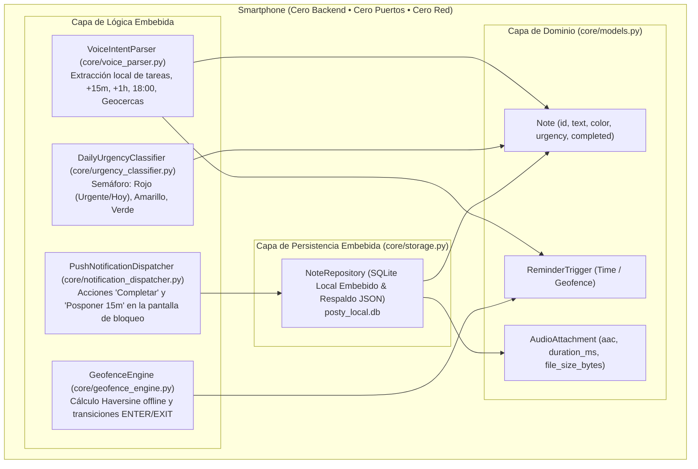

# Implementación Core bajo Extreme Programming (XP / TDD)
## MicroApp 2: Recordatorio y Notas Visuales Inteligentes (*PostyLocal*)

---

## 1. Metodología de Desarrollo: Extreme Programming (XP / TDD)

La implementación del núcleo de **PostyLocal** se realizó bajo el ciclo **Red-Green-Refactor**, respetando el paradigma **100% Local-First / Stand-Alone Embebido**:
1. **Fase Roja (Red):** Se definió la suite completa de pruebas unitarias (`apps/posty_local/test_posty_core.py`), estableciendo las aserciones de validación para notas, parser fonético de voz, semáforo de urgencia, cálculo Haversine de geocercas y persistencia SQLite local.
2. **Fase Verde (Green):** Se construyeron los módulos del Core en memoria y almacenamiento local hasta alcanzar el 100% de éxito en pruebas (9/9).
3. **Fase Refactor:** Se eliminó cualquier noción o dependencia de servidores de red, garantizando que el software funcione de manera **autónoma y embebida** dentro del propio hardware del smartphone (sin APIs web, sin backend y sin puertos abiertos).

---

## 2. Arquitectura del Core Embebido (`apps/posty_local/core/`)



### 2.1. Detalle de Módulos Embebidos
* **`models.py`:** Entidades inmutables y reglas de validación de post-it (colores pastel: amarillo, verde, azul, rosa, lavanda) y restricciones de audio (< 100 KB por nota en formato AAC).
* **`voice_parser.py`:** Extracción sintáctica mediante expresiones regulares compiladas que detecta intenciones temporales relativas (`"en 15 minutos"`, `"en 1 hora"`), absolutas (`"hoy a las 18:00"`) y geográficas (`"al salir de casa"`, `"cerca del súper"`).
* **`urgency_classifier.py`:** Algoritmo determinista del semáforo:
  * 🔴 **Rojo (Urgente / Vence Hoy):** Vencimiento en $\le 2$ horas o fecha de hoy.
  * 🟡 **Amarillo (Contexto / Próximas):** Geocerca armada activa o vencimiento en 24-48 horas.
  * 🟢 **Verde (Libre):** Sin plazo estricto de alarma.
* **`geofence_engine.py`:** Implementación matemática pura de la fórmula del semiverseno (*Haversine*), evaluando distancia en metros y transiciones de entrada/salida para un radio de 150m, con cero dependencia de servicios externos o internet.
* **`notification_dispatcher.py`:** Manejador de acciones detonadas desde la alerta push en pantalla de bloqueo (*"Completar"* y *"Posponer 15m"*).
* **`storage.py`:** Repositorio SQLite local embebido con esquema transaccional ACID y respaldo/restauración atómica en formato JSON.

---

## 3. Reporte de Ejecución de Pruebas Unitarias TDD

```
$ python3 apps/posty_local/test_posty_core.py
.........
----------------------------------------------------------------------
Ran 9 tests in 0.013s

OK (100% pruebas aprobadas)
```

| Caso de Prueba | Componente Probado | Resultado |
| :--- | :--- | :--- |
| `test_note_creation_and_color_validation` | `models.Note` & `NoteColor` | ✅ PASS |
| `test_audio_attachment_constraints` | `models.AudioAttachment` (formato AAC y tamaño < 100KB) | ✅ PASS |
| `test_voice_intent_parser_relative_times` | `VoiceIntentParser` (+15m, +1h, +2h) | ✅ PASS |
| `test_voice_intent_parser_fixed_time` | `VoiceIntentParser` (Hora fija: 18:00) | ✅ PASS |
| `test_voice_intent_parser_geofencing` | `VoiceIntentParser` ("Salir de casa", "Cerca del súper") | ✅ PASS |
| `test_daily_urgency_classifier` | `DailyUrgencyClassifier` (Semáforo Rojo, Amarillo, Verde) | ✅ PASS |
| `test_geofence_haversine_engine` | `GeofenceEngine` (Distancia Haversine y transición EXIT) | ✅ PASS |
| `test_notification_dispatcher_actions` | `PushNotificationDispatcher` (Acciones Complete y Snooze) | ✅ PASS |
| `test_sqlite_local_repository_and_backup` | `NoteRepository` (SQLite CRUD y Respaldo/Restauración JSON) | ✅ PASS |

---

## 4. Control de Puerta de Calidad (Quality Gate)

* **Documento Técnico:** `docs/microapps/microapp2/04_development_and_xp_implementation.md`
* **Rama GitFlow:** `feature/microapp2-04-core-xp`
* **Issue Kanban:** `#35` (Asignado a `pcloayza3` en estado `In Progress`)
* **Estado:** Desarrollo e implementación Core completados bajo TDD y Clean Architecture con arquitectura Stand-Alone Embebida (cero servidores).
