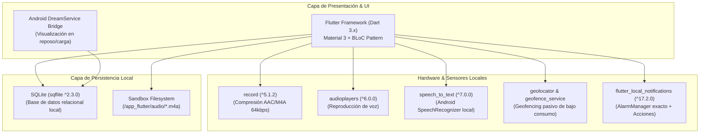

# Especificación del Stack Tecnológico
## MicroApp 2: Recordatorio y Notas Visuales Inteligentes (*PostyLocal*)

---

## 1. Visión General del Stack Tecnológico

El stack tecnológico de **PostyLocal** se selecciona bajo los principios de **arquitectura Local-First**, **cero telemetría externa**, **alta velocidad de captura (≤ 3 segundos)** y **eficiencia energética**. Toda la pila de software se ejecuta íntegramente en el hardware del dispositivo móvil (Android / iOS).



---

## 2. Detalle de Componentes y Justificación Técnica

### 2.1. Framework de Presentación Móvil
* **Tecnología:** **Flutter (Dart 3.x)** con Material Design 3.
* **Justificación:**
  * Compilación nativa directa a código máquina (ARM64 AOT), logrando 60/120 fps constantes en renderizado de tarjetas de colores estilo *post-it*.
  * Ecosistema ya integrado y validado en `plataforma01` (iniciativa `clinik_local`), permitiendo reutilizar la cadena de empaquetado APK y herramientas de testing.
  * Facilidad para construir interfaces accesibles con soporte táctil ergonómico (botones ≥ 48dp).

### 2.2. Motor de Persistencia de Datos
* **Tecnología:** **SQLite** a través del plugin **`sqflite` (^2.3.0)** y **`path_provider` (^2.1.0)**.
* **Justificación:**
  * Motor relacional ligero, embebido y transaccional (ACID) que garantiza integridad de datos sin necesidad de servicios backend externos.
  * Consultas indexadas por proximidad de vencimiento (`due_timestamp ASC`), permitiendo tiempos de lectura inferiores a 10 milisegundos para ordenar el semáforo diario.

### 2.3. Módulo de Audio Dual (Grabación y Playback)
* **Grabador:** **`record` (^5.1.2)**
  * Codificación nativa en formato AAC/M4A mono a 64 kbps con tasa de muestreo de 16 kHz.
  * Genera archivos de audio ultra-livianos (< 100 KB por nota de voz de 15 segundos) en el directorio privado de la aplicación (`/data/user/0/.../app_flutter/audio/`).
* **Reproductor:** **`audioplayers` (^6.0.0)**
  * Control reactivo de estados (Play, Pause, Resume, Stop) con stream de posición en tiempo real para la barra de avance del *post-it*.

### 2.4. Módulo de Transcripción por Voz (Speech-to-Text)
* **Tecnología:** **`speech_to_text` (^7.0.0)**.
* **Justificación:**
  * Conexión directa con la API del sistema operativo (`android.speech.SpeechRecognizer`), permitiendo transcripción fonética continua y en tiempo real.
  * Funciona completamente sin internet cuando el usuario tiene instalado el paquete de reconocimiento de voz sin conexión de Android (Google Speech Services Offline).

### 2.5. Módulo de Alertas Push Locales y Alarmas Exactas
* **Tecnología:** **`flutter_local_notifications` (^17.2.0)**.
* **Justificación:**
  * Integración con el `AlarmManager` nativo de Android mediante el método `zonedSchedule(exactAllowWhileIdle: true)`, lo que garantiza el despertar del procesador y emisión de la alerta sonora/vibración aun cuando el smartphone esté en modo Doze.
  * Soporte nativo para botones de acción rápida en la notificación (`AndroidNotificationAction`):
    * Acción *"Completar"*: Tacha la nota en SQLite en segundo plano.
    * Acción *"Posponer 15m"*: Reprograma la alarma automáticamente sumando 15 minutos.

### 2.6. Módulo de Geofencing y Ubicación Pasiva
* **Tecnología:** **`geolocator` (^12.0.0)** y **`geofence_service` (^5.2.0)** (Android Geofencing API).
* **Justificación:**
  * El servicio de geofencing opera a nivel de hardware combinando antenas de telefonía móvil y redes WiFi circundantes para detectar el cruce de perímetro (radio estándar de 150m), evitando el encendido continuo del chip GPS para mantener el consumo de batería por debajo del 2.5% diario.

### 2.7. Módulo de Protector de Pantalla (Screensaver / AOD)
* **Tecnología:** **Android `DreamService` nativo (Kotlin) + Flutter Embedding**.
* **Justificación:**
  * Se implementa un servicio nativo derivado de `android.service.dreams.DreamService` registrado en el `AndroidManifest.xml`.
  * Al activarse el protector de pantalla del sistema (cuando el teléfono se coloca en un cargador o base), despliega la vista nocturna minimalista con fondo negro absoluto (#000000) mostrando la hora actual y las 3 actividades más urgentes del día consultadas directamente de la base de datos SQLite local.

### 2.8. Gestión de Estado y Arquitectura Interna
* **Tecnología:** **`flutter_bloc` (^8.1.3)**.
* **Justificación:**
  * Separa estrictamente la interfaz gráfica de la lógica de negocio, facilitando el desarrollo bajo Extreme Programming con Test-Driven Development (TDD).

---

## 3. Matriz de Dependencias (pubspec.yaml)

```yaml
dependencies:
  flutter:
    sdk: flutter

  # Persistencia Local
  sqflite: ^2.3.0
  path_provider: ^2.1.0
  path: ^1.9.0

  # Voz y Audio Dual
  speech_to_text: ^7.0.0
  record: ^5.1.2
  audioplayers: ^6.0.0

  # Alertas y Notificaciones Locales
  flutter_local_notifications: ^17.2.0
  timezone: ^0.9.2

  # Geolocalización y Geofencing
  geolocator: ^12.0.0
  geofence_service: ^5.2.0

  # Gestión de Estado
  flutter_bloc: ^8.1.3
  equatable: ^2.0.5

dev_dependencies:
  flutter_test:
    sdk: flutter
  mocktail: ^1.0.4
  bloc_test: ^9.1.7
```

---

## 4. Control de Puerta de Calidad (Quality Gate)

* **Documento Técnico:** `docs/microapps/microapp2/04_tech_stack_specification.md`
* **Rama GitFlow:** `feature/microapp2-04-tech-stack`
* **Issue Kanban:** `#33` (Asignado a `pcloayza3` en estado `In Progress`)
* **Estado:** Especificación de stack tecnológico completada para validación y aprobación formal del usuario.
