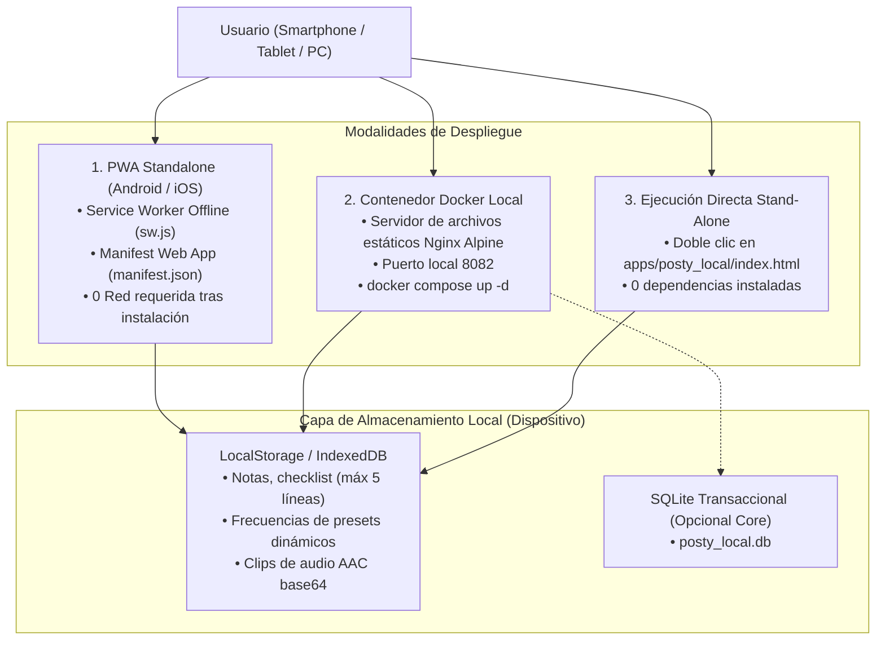

# MicroApp 2: PostyLocal • Fase 6: Despliegue y Mantenimiento (GitFlow & Release)

**Estado:** Aprobado y Preparado para Release  
**Fecha:** 15 de Octubre de 2026  
**Versión de Entrega:** `v1.0.0-postylocal` (SemVer 2.0.0)  
**Trazabilidad:** [Issue #38](https://github.com/pcloayza3/plataforma01/issues/38) | Asignado a: `pcloayza3`  
**Rama GitFlow:** `feature/microapp2-06-deployment-maintenance`

---

## 1. Arquitectura y Modalidades de Despliegue

PostyLocal está diseñado bajo el paradigma **100% Local-First y Stand-Alone**, garantizando soberanía absoluta de los datos, latencia cero y funcionamiento pleno sin conexión a internet ni dependencia de servidores centrales.



---

## 2. Modalidades de Despliegue Paso a Paso

### Modalidad A: Instalación como PWA en Smartphone (Recomendada para Móviles)
1. **Acceso Inicial:** Abrir la URL local o IP de red local (ej. `http://<ip-local>:8082` o desplegado en hosting estático).
2. **Instalación Nativa:**
   * En **Android (Chrome):** Pulsar el menú `⋮` y seleccionar **"Instalar aplicación"** o **"Añadir a pantalla de inicio"**.
   * En **iOS (Safari):** Pulsar el icono Compartir y seleccionar **"Añadir a la pantalla de inicio"**.
3. **Uso Desconectado:** La aplicación se abre en ventana completa independiente (sin barra de direcciones de navegador), funcionando 100% offline gracias al Service Worker [`apps/posty_local/sw.js`](file:///Users/paul/develop/platform01/apps/posty_local/sw.js) y [`apps/posty_local/manifest.json`](file:///Users/paul/develop/platform01/apps/posty_local/manifest.json).

### Modalidad B: Contenedor Docker Local (Servidor de Archivos Estáticos)
Para ejecutar un entorno local aislado y ligero sin dependencias del sistema:
```bash
# Iniciar contenedor Docker en segundo plano
cd apps/posty_local
docker compose up -d --build

# Verificar estado del servicio
docker compose ps

# Abrir en navegador
# http://localhost:8082
```

### Modalidad C: Ejecución Directa sin Servidor
Para un uso inmediato de máxima privacidad:
```bash
# Abrir directamente en el navegador predeterminado (macOS)
open apps/posty_local/index.html

# En Linux: xdg-open apps/posty_local/index.html
# En Windows: start apps\posty_local\index.html
```

---

## 3. Estrategia de Versionado Semántico (SemVer 2.0.0)

La versión oficial de entrega para MicroApp 2 es **`v1.0.0-postylocal`**:

| Nivel SemVer | Convención | Criterio de Incremento |
|---|---|---|
| **MAJOR** (`v2.0.0`) | Cambios incompatibles | Modificaciones estructurales en el formato de datos de respaldo JSON o cambio radical de interfaz. |
| **MINOR** (`v1.1.0`) | Nuevas funcionalidades retrocompatibles | Adición de nuevos sensores de activación, categorías personalizadas o soporte de más idiomas. |
| **PATCH** (`v1.0.1`) | Correcciones y ajustes | Ajustes menores en estilos CSS, optimizaciones de animaciones o correcciones de cálculo Haversine. |

---

## 4. Políticas de Soberanía de Datos y Mantenimiento

### 4.1. Respaldo Atómico y Restauración (Backup & Restore)
* **Exportación JSON:** El usuario puede pulsar en `⚙️ Configuración` > `📥 Exportar Notas & Audios (JSON)` para descargar un archivo con la totalidad de:
  * Notas activas y sus colores inmediatos.
  * Checklist de hasta 5 líneas con estados de check y clips de audio individuales.
  * Tareas realizadas archivadas en modo solo lectura.
  * Historial de frecuencia de presets dinámicos de tiempo y ubicación.
  * Coordenadas de geocercas configuradas.
* **Restauración:** Mediante la carga del archivo JSON, la aplicación valida la integridad del esquema y restaura de forma atómica el estado de la aplicación sin colisiones.

### 4.2. Mantenimiento Preventivo y Optimización del Almacenamiento
* **Gestión de Cuota:** Dado que los clips de voz están optimizados (≤ 15 segundos y ≤ 100 KB en AAC), 100 notas con audio ocupan menos de 10 MB, permaneciendo dentro del límite seguro de IndexedDB/LocalStorage (50 MB+).
* **Purga de Tareas Realizadas:** La sección de tareas realizadas almacena las actividades completadas sin degradar el rendimiento del semáforo activo. El usuario puede limpiar el historial mediante restablecimiento controlado.
* **Bajo Consumo de Batería:** El motor de geocercas utiliza eventos espaciales pasivos (geocerca circular de 150m) sin *polling* continuo de GPS, preservando la autonomía del smartphone.

---

## 5. Control de Versiones con GitFlow y Procedimiento de Release

1. **Integración en `develop`:** La rama `feature/microapp2-06-deployment-maintenance` se fusiona hacia `develop`.
2. **Generación de Release Branch:** Se genera la rama `release/v1.0.0-postylocal` desde `develop` para verificación final.
3. **Fusión en `main`:** Integración a la rama estable `main` mediante Pull Request sin avance rápido (`--no-ff`).
4. **Etiquetado (Tagging):** Creación del tag anotado `v1.0.0-postylocal` en `main`.
5. **Cierre de Issue en Kanban:** [Issue #38](https://github.com/pcloayza3/plataforma01/issues/38) actualizado a la columna `Done`.
